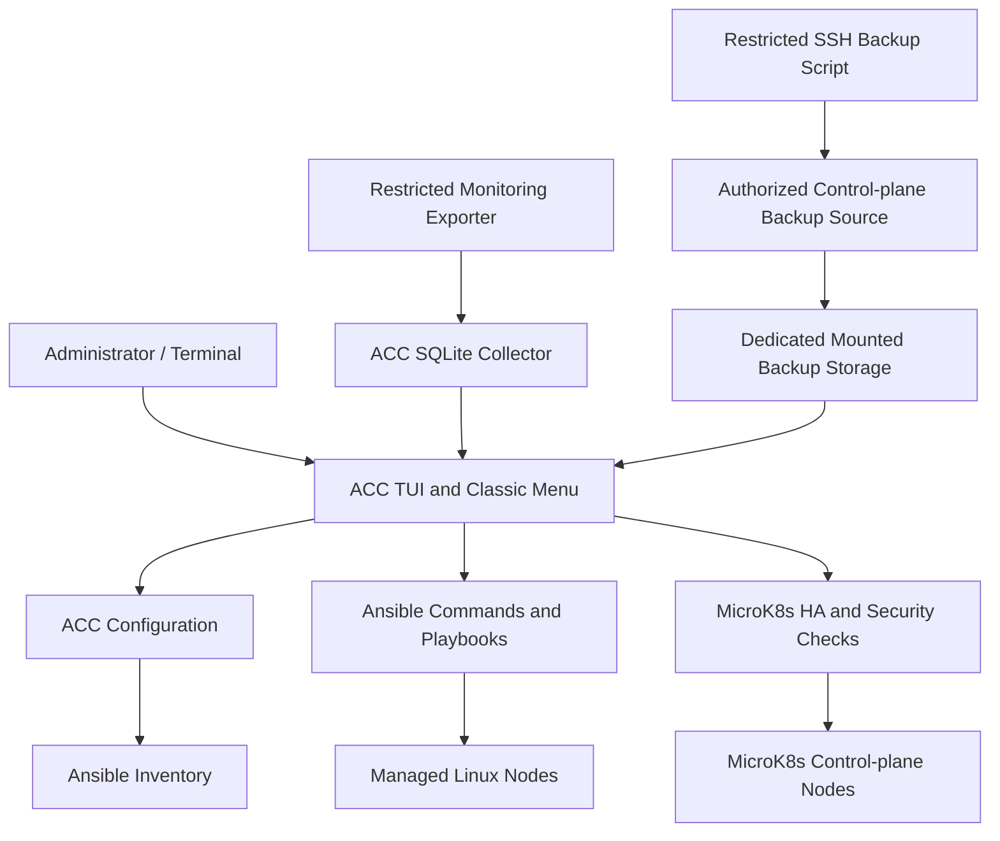

# Ansible Control Center (ACC)

**Self-hosted Linux infrastructure management and MicroK8s operations from a terminal-first control center.**

[](#project-status) [](LICENSE) [](#requirements) [](#requirements)

Ansible Control Center (ACC) brings Linux server administration, Ansible workflows, Kubernetes health visibility, security checks, and backup status into one self-hosted toolkit. It was developed from an operational homelab and cluster management environment and is being prepared for reusable installations.

**Created by Jeff Swenson with assistance from OpenAI GPT-6.**

> [!WARNING]
> **Experimental source release.** The exported code has passed focused static checks and selected offline authorization tests, but a complete installer, end-to-end deployment validation, security assessment, and backup restore drill are not finished. Do not replace a working production installation or run administrative scripts against critical infrastructure without independent review.

## Contents

- [What ACC does](#what-acc-does)
- [System architecture](#system-architecture)
- [Interface and modules](#interface-and-modules)
- [Security model](#security-model)
- [Requirements](#requirements)
- [Getting started for developers](#getting-started-for-developers)
- [Configuration](#configuration)
- [Operations and safety](#operations-and-safety)
- [Backups and recovery](#backups-and-recovery)
- [Repository layout](#repository-layout)
- [Validation](#validation)
- [Development roadmap](#development-roadmap)
- [Documentation](#documentation)
- [License and attribution](#license-and-attribution)

## What ACC does

| Area | Capabilities in the exported source | Caveats |
|---|---|---|
| Terminal dashboard | TUI and classic command-line menu | Packaging and launch paths may need adaptation |
| Fleet management | Inventory visibility, Ansible checks and playbook entry points | Some scripts assume an Ansible-managed Linux environment |
| Worker maintenance | Explicitly authorized updates and reboots; a cordon/drain/upgrade workflow | Disruptive: verify workloads and authorization first |
| MicroK8s HA | Status, node visibility, dqlite membership inspection | Health reports are not proof of successful failover |
| Monitoring | Restricted exporter, local SQLite telemetry and alert state | Deployment and service installation need review |
| Kubernetes security | Certificate, token and API checks | Credential prerequisites and permissions must be provisioned |
| Backups | Restricted SSH backup flow, archive integrity checks and status reporting | Restore not validated; service template needs rendering |

ACC emphasizes **local control**, **explicit node roles**, and **fail-closed administration** over automatically guessing what is safe to change.

## System architecture



The controller is typically a separate Linux host. The HA topology in the current example uses **three masters and two workers**; those are *roles*, not baked-in production addresses. Hostnames and inventory addresses must be supplied by each deployment.

For a closer look, see [docs/architecture.md](docs/architecture.md).

## Interface and modules

### Terminal dashboard

`src/acc-tui` provides a Python terminal UI for presenting controller and fleet information. `src/ansible-menu` is the launcher and `src/ansible-menu-classic` contains the classic operations interface. The launcher may refer to installed paths; inspect it before launching from a clone.

**Screenshot placeholder:** Screenshots will be added after the portable installation and sample dashboard workflow are verified. No screenshots are included in this release.

### Role-aware maintenance

The configuration and policy modules work together:

- `src/acc_config.py` — reads and validates the configuration file.
- `src/acc_ha_inventory.py` — resolves declared HA master addresses through Ansible inventory.
- `src/acc_node_policy.py` — rejects unrecognized, overlapping, and malformed node role assignments.
- `src/acc_cluster_policy.py` — resolves the configured three-master set.
- `src/ha-membership-check.py` — inspects reported MicroK8s HA membership.

Selected worker maintenance commands were tested offline with mocked inventory and Ansible calls. That is **not** a comprehensive authorization review for every menu action.

### Monitoring and incident state

The repository includes a local telemetry collector (`monitoring/acc-monitor`), an SSH-compatible restricted exporter (`monitoring/acc-monitor-export`), and monitoring systemd unit files. The collector persists samples and incident state in SQLite under its configured/local application state directory. Do not commit runtime databases or monitoring credentials.

### Cluster visibility and API security

MicroK8s utilities cover HA status, Kubernetes health, certificate renewal preflight checks, and API authentication testing. A certificate or API health check should not be interpreted as proof of dqlite quorum or restored cluster functionality.

## Security model

The design is intentionally conservative:

1. **Explicit master/worker membership.** Unknown hosts must not gain worker maintenance privileges.
2. **Inventory-backed addresses.** Control-plane identities must resolve from validated configuration, not assumptions about an IP subnet.
3. **Fail-closed configuration.** Missing role information should block privileged workflows rather than fall back silently.
4. **Prompted disruptive actions.** Existing menu workflows require confirmation for sensitive updates and reboots.
5. **Restricted backup access.** The remote backup account is command-restricted, and SSH host key checking remains enabled.
6. **Private deployment state.** Live inventory files, SSH private keys, Kubernetes credentials, SQLite databases and backup archives must stay out of Git.

Some administrative functions can still alter servers or Kubernetes resources. Review every playbook and command before running. See [docs/security.md](docs/security.md).

## Requirements

**For source review and offline development:** Linux, Python 3, Git, and Bash.

**For actual infrastructure operations:** Ansible, OpenSSH, accessible Linux managed hosts, a correctly provisioned inventory, appropriate privilege escalation, and MicroK8s for Kubernetes-specific commands. Backup workflows additionally require a dedicated mounted filesystem and a restricted remote backup account. Fedora was used in the original controller environment, but this repository does **not** yet promise an installation supported across Linux distributions.

## Getting started for developers

Clone the repository:

```bash
git clone https://github.com/mtwebmaster/Ansible-Control-Center.git
cd Ansible-Control-Center
```

Create a local configuration from the sample:

```bash
mkdir -p "$HOME/.config/ansible-control-center"
cp config/examples/config.json.example "$HOME/.config/ansible-control-center/config.json"
chmod 600 "$HOME/.config/ansible-control-center/config.json"
```

**Edit the new configuration before doing anything else.** The sample contains fictional master/worker names, example inventory addresses, and placeholder storage settings.

For static checks that do not contact remote servers:

```bash
python3 -m compileall -q src monitoring kubernetes/security
bash -n backup/backup-daily.sh
git diff --check
```

These are syntax checks, not proof that runtime behavior is safe. A production installer and complete offline test suite are planned, but not included in this release. See [docs/installation.md](docs/installation.md).

## Configuration

The default configuration location is:

```text
~/.config/ansible-control-center/config.json
```

You can also use `ACC_CONFIG` to select another configuration file for supported utilities. The example is at [`config/examples/config.json.example`](config/examples/config.json.example).

| Section | Settings | Meaning |
|---|---|---|
| Root | `inventory`, `ssh_key`, `management_user` | Ansible inventory and management identity |
| `microk8s` | `masters`, `workers`, `dqlite_port`, `api_port` | Explicit HA roles and control-plane ports |
| `monitoring` | `ssh_user`, `ssh_key`, `collection_interval_seconds` | Restricted node telemetry |
| `backups` | `directory`, `mount_point`, `remote_host`, `ssh_user`, `ssh_key` | Backup storage and restricted remote source |

The current HA policy expects **exactly three distinct configured masters**. The selected backup source must be one of those masters. The backup directory must sit beneath the designated mount point. The sample paths are not an instruction to create a real backup volume.

Details: [docs/configuration.md](docs/configuration.md).

## Operations and safety

| Operation | Risk | Guidance |
|---|---|---|
| Inventory/status checks | Usually read-only | Review the specific command invoked |
| Node package upgrade | Changes host state | Review pending upgrades and service impact |
| Worker reboot | Disruptive | Prefer draining workloads where applicable |
| Worker cordon/drain | Disruptive to scheduling | Verify available capacity and disruption budgets |
| Master maintenance | Potential quorum loss | **Not covered by ordinary worker workflows**; require a separate quorum-aware procedure |
| Backup setup | Changes remote privileges/services | Review SSH forced command and sudoers scope |

**Never run simultaneous maintenance or reboots on multiple HA masters.** ACC's read-only HA observations are informational and do not replace a documented and tested control-plane maintenance plan.

## Backups and recovery

The backup subsystem is intended to retrieve datastore backup artifacts over a restricted SSH channel, check archive integrity, and store metadata alongside archives on a dedicated filesystem. The source includes `backup/backup-daily.sh`, `backup/microk8s-backup-gate`, `backup/microk8s-export-backup`, and a **systemd template** at `config/templates/microk8s-backup.service.in`.

**Do not enable the template verbatim.** It contains installation placeholders, and there is no validated portable installer that fills them in yet. The backup utility is also not a substitute for a full application/workload backup strategy.

A good backup report is not a successful restore. Before relying on this system, test restoration in an isolated environment. See [docs/backups.md](docs/backups.md).

## Repository layout

```text
Ansible-Control-Center/
├── README.md
├── LICENSE
├── ansible/
│   ├── monitoring/
│   └── playbooks/
├── backup/
│   ├── backup-daily.sh
│   ├── microk8s-backup-gate
│   ├── microk8s-export-backup
│   └── setup-remote.yml
├── config/
│   ├── examples/
│   └── templates/
├── docs/
├── kubernetes/
│   └── security/
├── monitoring/
├── src/
│   ├── acc-tui
│   ├── ansible-menu
│   ├── ansible-menu-classic
│   ├── acc_config.py
│   ├── acc_node_policy.py
│   └── ha-membership-check.py
└── systemd/
```

This is an abbreviated map; additional security and helper scripts appear under `src/` and `kubernetes/security/`.

## Validation

The exported release underwent targeted checks during source preparation, including Python syntax validation, Bash syntax validation, YAML syntax checking for the remote backup playbook, and offline simulated tests of selected worker authorization and backup host resolution behaviors.

**Not yet verified:** complete clean-host install, all menu execution paths, failover testing, independent security audit, unattended backup service deployment, and an end-to-end datastore restore. The repository should be treated as experimental until those checks are completed.

## Development roadmap

- [x] Export and version-control the ACC application source
- [x] Add an MIT License and example configuration
- [x] Introduce inventory-based HA and worker-role authorization modules
- [x] Add portable backup configuration reader and systemd service template
- [ ] Complete public-source security and privacy review
- [ ] Build and test a portable installer/uninstaller
- [ ] Add automated unit tests and CI
- [ ] Validate full TUI and classic-menu workflows from a fresh clone
- [ ] Exercise backup failure paths and a documented test restore
- [ ] Add screenshots and a reproducible demo environment
- [ ] Publish a tagged alpha release after acceptance testing

## Documentation

- [Architecture](docs/architecture.md)
- [Installation and development setup](docs/installation.md)
- [Configuration reference](docs/configuration.md)
- [Security guidelines](docs/security.md)
- [Backup architecture and recovery readiness](docs/backups.md)

## Contributing

Issues and pull requests are welcome for review, testing, documentation, and portable packaging. Describe the target environment, steps to reproduce, and any safeguards involved. **Never attach real private keys, access tokens, production inventory files, internal IP maps, or unredacted logs.**

## License and attribution

MIT License — see [LICENSE](LICENSE).

Copyright © 2026 Jeff Swenson.

Developed by Jeff Swenson with assistance from OpenAI GPT-6. No affiliation with, endorsement by, or support commitment from OpenAI, Canonical, Ansible, or the MicroK8s project is implied.
